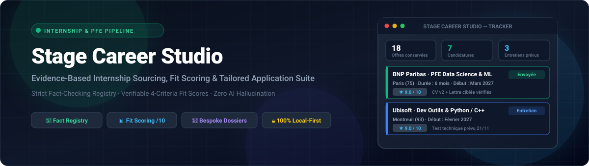
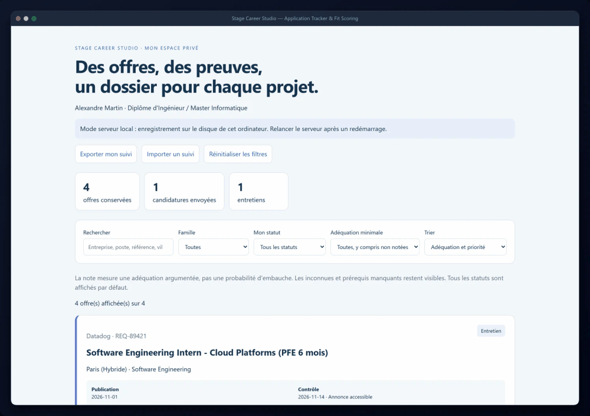
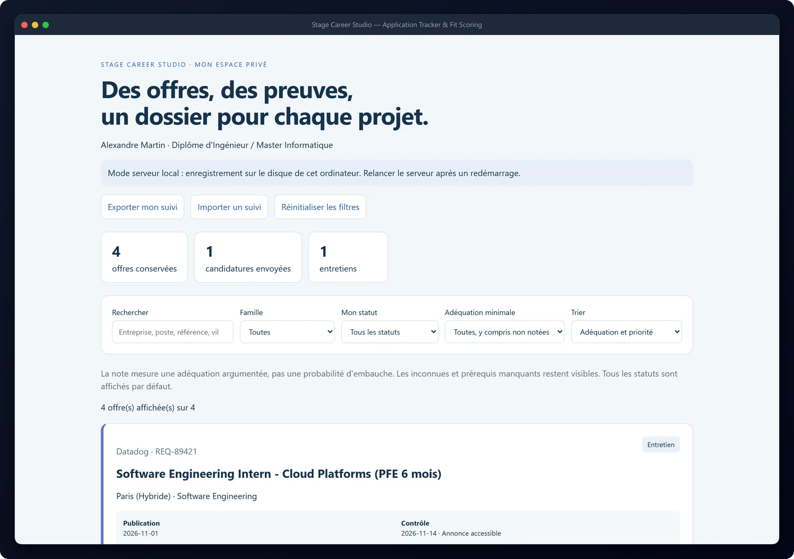
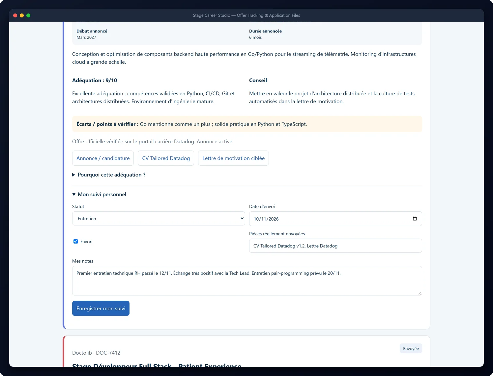
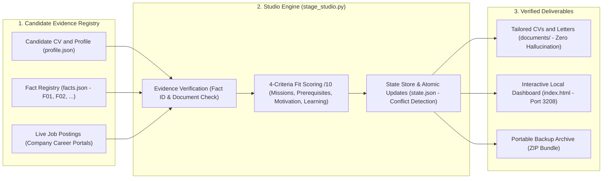

<div align="center">



# Stage Career Studio

**Local-first, evidence-based internship pipeline &amp; fit-scoring studio with zero AI hallucination**

[](https://github.com/Emincanozen/stage-career-studio/actions/workflows/ci.yml)
[](https://www.python.org/)
[](LICENSE)
[](#why-it-is-different)
[](#privacy--security)

<p align="center">
  <a href="#live-demo">Live Demo</a> •
  <a href="#screenshots">Screenshots</a> •
  <a href="#architecture">Architecture</a> •
  <a href="#why-it-is-different">Why It Is Different</a> •
  <a href="#repository-structure">Repository Structure</a> •
  <a href="#how-to-install--configure">Installation</a> •
  <a href="#how-to-use">Usage Guide</a> •
  <a href="#testing">Testing</a>
</p>

</div>

---

> **Note on Language:** The methodology reference files (`SKILL.md` and `references/`) are documented in French (the primary language for French engineering/business stage &amp; PFE markets), while the assistant communicates seamlessly in any language requested (English, French, Turkish, etc.).

---

## Live Demo

<div align="center">
  
  <p><em>Real-time interaction showing stage search metrics, instantaneous status filtering, expandable candidate dossier notes, and 4-criteria fit scores.</em></p>
</div>

---

## Screenshots

<table>
  <tr>
    <td width="50%" align="center">
      <strong>Interactive Application Tracking Dashboard</strong><br/><br/>
      
    </td>
    <td width="50%" align="center">
      <strong>Candidate Tracking &amp; Evidence Breakdown</strong><br/><br/>
      
    </td>
  </tr>
</table>

---

## Architecture

Stage Career Studio enforces an air-gapped, verifiable data pipeline where every output is backed by primary candidate evidence and strict schema validation:



---

## Why It Is Different

- **Facts First:** Every candidate achievement has an ID, a verified source, a confirmation date, and an explicit status (`confirmed`, `ambiguous`, `planned`). Zero invented skills or inflated claims.
- **Evidence-Based Scoring:** Transparent `/10` ratings broken into 4 weighted components (missions, prerequisites, motivation, learning) with clear explanations—never a vague hiring probability.
- **Prepare Only:** The assistant and dashboard *never* send applications or external emails autonomously. You review, approve, and send every document yourself.
- **Privacy by Design:** One private directory per candidate on your local workstation. Your personal data never leaves your computer or gets uploaded to cloud trackers.
- **Zero External Dependencies:** Built entirely with the Python 3.10+ standard library and native HTML/CSS/JavaScript. No third-party packages, no API keys, and no database configuration required.

---

## Repository Structure

| Path | Purpose |
| :--- | :--- |
| `skills/stage-career-studio/SKILL.md` | Primary assistant skill definition and interview workflow instructions |
| `skills/stage-career-studio/references/` | Domain guides: candidate interview, search & fit scoring, CV & letter tailoring, dashboard lifecycle |
| `skills/stage-career-studio/scripts/stage_studio.py` | Local CLI toolkit: `init`, `validate`, `upsert`, `build`, `serve`, `bundle` |
| `skills/stage-career-studio/assets/dashboard.html` | Self-contained, responsive dashboard template with offline `localStorage` fallback |
| `skills/stage-career-studio/assets/profile.template.json` | Blank candidate profile schema |
| `docs/` | Quick-start documentation and ready-to-paste prompt for ChatGPT |
| `.codex-plugin/plugin.json` | Codex / Antigravity plugin manifest |

---

## How to Install & Configure

### Prerequisites
- **Python 3.10+** (using only the standard library)
- *(Optional)* **Node.js** (only required if running the automated dashboard JavaScript test suite)
- An AI coding assistant (OpenAI Codex, Claude Code, Antigravity, or ChatGPT)

### Option A: Local CLI Installation
1. Clone the repository:
   ```bash
   git clone https://github.com/Emincanozen/stage-career-studio.git
   cd stage-career-studio
   ```

2. Verify your Python version (must be 3.10 or higher):
   ```bash
   python --version  # or 'py -V' on Windows
   ```

3. Run the automated test suite to verify your setup:
   ```bash
   python -m unittest discover -s skills/stage-career-studio/scripts
   ```

### Option B: AI Agent Skill Installation
Install the skill into your preferred AI agent environment:
- **Codex / Claude Code / Antigravity:**
  Copy `skills/stage-career-studio` into your agent's skills directory:
  ```bash
  # Windows
  xcopy /E /I skills\stage-career-studio %USERPROFILE%\.agents\skills\stage-career-studio
  # macOS / Linux
  cp -r skills/stage-career-studio ~/.agents/skills/stage-career-studio
  ```
- **ChatGPT Web:**
  1. Download this repository as a ZIP archive (**Code > Download ZIP**).
  2. Start a new conversation and attach the ZIP archive alongside your current CV.
  3. Copy and paste the starter prompt from [`docs/PROMPT_CHATGPT.fr.txt`](docs/PROMPT_CHATGPT.fr.txt).

---

## How to Use

### 1. Initialize a Private Candidate Workspace
Create a new, isolated directory for your internship search:
```bash
python skills/stage-career-studio/scripts/stage_studio.py init ~/my-internship-search
```
This generates the workspace structure:
```
my-internship-search/
├── profile.json       # Candidate degree, preferences, constraints
├── facts.json         # Confirmed candidate achievements & skills
├── offers.json        # Verified internship opportunities & ratings
├── state.json         # Private application status, notes, dates
├── documents/         # Tailored CVs and cover letters
├── REPRISE.md         # Markdown search journal & next steps
└── index.html         # Pre-compiled local dashboard
```

### 2. Conduct the Candidate Discovery Interview
Ask your AI assistant:
> *"Use $stage-career-studio to guide my internship search. Here is my current CV. Interview me to identify confirmed facts, clarify ambiguous experiences, and establish my search criteria."*

The assistant populates `facts.json` with factual evidence IDs (e.g. `F01`, `F02`) and updates `profile.json`.

### 3. Evaluate and Upsert Internship Offers
When you or your assistant discover new internship postings, validate and import them:
```bash
python skills/stage-career-studio/scripts/stage_studio.py upsert ~/my-internship-search new_offers.json
```

### 4. Rebuild and Launch the Local Dashboard
```bash
# Rebuild the standalone static HTML dashboard
python skills/stage-career-studio/scripts/stage_studio.py build ~/my-internship-search

# Launch the secure local web server (binds strictly to 127.0.0.1)
python skills/stage-career-studio/scripts/stage_studio.py serve ~/my-internship-search --port 8781
```
Open **`http://127.0.0.1:8781/index.html`** in your browser to view and manage your applications. Changes made in the web UI are saved directly to `state.json` on disk.

### 5. Create a Private Backup Bundle
Export your entire candidate folder into an encrypted or portable ZIP file:
```bash
python skills/stage-career-studio/scripts/stage_studio.py bundle ~/my-internship-search backup-search.zip
```

---

## How to Create / Customize

### 1. Tailoring Truthful CVs and Cover Letters
All documents generated by the studio adhere to the **Zero Hallucination Rule**:
- Every bullet point on your tailored CV must map to a `confirmed` fact ID in `facts.json`.
- Missing skills or unfamiliar tools are explicitly classified as gaps or planned learning objectives—never claimed as existing proficiencies.
- Store tailored PDFs or Markdown drafts in `documents/` (e.g., `documents/cv_datadog_swe.pdf`) and register them in the offer's `documents` array.

### 2. Customizing the Evidence-Based Scoring Algorithm
Offer ratings are calculated using four weighted components totaling 10.0 points:

| Component | Weight | Criteria Evaluated |
| :--- | :---: | :--- |
| `missions` | **4.0 pts** | Direct alignment between daily job duties and candidate's confirmed experience |
| `prerequisites` | **3.0 pts** | Core languages, frameworks, degrees, and language requirements |
| `motivation` | **2.0 pts** | Alignment with preferred company culture, product sector, and role preferences |
| `learning` | **1.0 pt** | Opportunities to acquire high-value skills matching planned career growth |

To tune these criteria, consult [`skills/stage-career-studio/references/recherche-et-adequation.md`](skills/stage-career-studio/references/recherche-et-adequation.md).

### 3. Customizing the HTML Dashboard
- **Styling & Themes:** Modify CSS custom properties in `skills/stage-career-studio/assets/dashboard.html` (`--blue`, `--line`, `--bg`, `--ink`).
- **Application Statuses:** Built-in statuses include:
  - `a_verifier` (*To verify / Review offer*)
  - `a_faire` (*To apply / Prepare documents*)
  - `envoyee` (*Applied / Awaiting response*)
  - `entretien` (*Interview scheduled*)
  - `offre` (*Offer received*)
  - `refus` (*Rejected*)
  - `ecartee` (*Passed / Not interested*)
  - `expiree` (*Expired / Closed*)
- **Offline Mode:** If running without the local HTTP server, the dashboard automatically falls back to browser `localStorage` and provides single-click JSON import/export buttons to prevent data loss.

---

## Testing

Run the automated test suite covering JSON schema validation, atomic file writes, version conflict prevention, path traversal security, and HTML injection escaping:

```bash
# Python unit tests
python -m unittest discover -s skills/stage-career-studio/scripts

# Dashboard engine tests (requires Node.js)
node skills/stage-career-studio/scripts/test_dashboard.cjs
```

---

## Privacy & Security

- Candidate workspaces (`profile.json`, `facts.json`, `offers.json`, `state.json`, `documents/`, `REPRISE.md`) contain personal data and are automatically excluded in `.gitignore`.
- The local server binds strictly to `127.0.0.1` and forbids external directory traversal.
- Never commit candidate folders or push personal resumes to public repositories.

---

## License

[MIT](LICENSE) © Emincanozen
